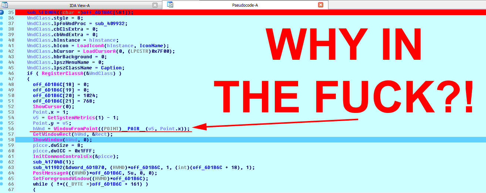

# Bloodline - Sui's fix
A fix for many issues plaguing Bloodline (2005) game by Zima Software.

### What it does:
* Prevents the game from using a window at coordinates 1,1 as a rendering window (generally it's Explorer.exe), which often resulting in Start button being broken after quitting the game.
* Improves widescreen support and suppressed setting a resolution of the screen.
* Fixes a bug related to string handling when reading ini file that would create a lot of folders all over your drive.AI assisted
* Improves mouse input when having irregular framerate (which is common with this game).AI assisted
* Adds caching of paths when loading assets, to speed up the loads and avoid excessive exploration of game's directories.AI assisted
* Fixes the game stealing input each frame making it impossible to "alt-tab" from the game.AI assisted
* Adds gamma adjustment with config file and keys `Shift`+`+` and `Shift`+`-`AI assisted

### What it does NOT do:
* Change the gameplay in any significant way.
* Fixes performance issues or softlocks or many absurd design decisions.

Requirements
----
* [Microsoft Visual C++ Redistributable 2017 (x86)](https://support.microsoft.com/en-us/help/2977003/the-latest-supported-visual-c-downloads)

Notes
----
* Featured marked with AI assisted were - as the name implies - developed with AI assistance (most likely using GLM 5.3). Not all generated code was used as is.
* Tested only with Polish release of the game.
* The last level for whatever reason uses a significantly lower field of view. It's not something I am willing to look into.
* The mouse may scroll windows that are not in focus. At this point - just use [DisplayLock](https://github.com/Stateford/Display-Lock).
